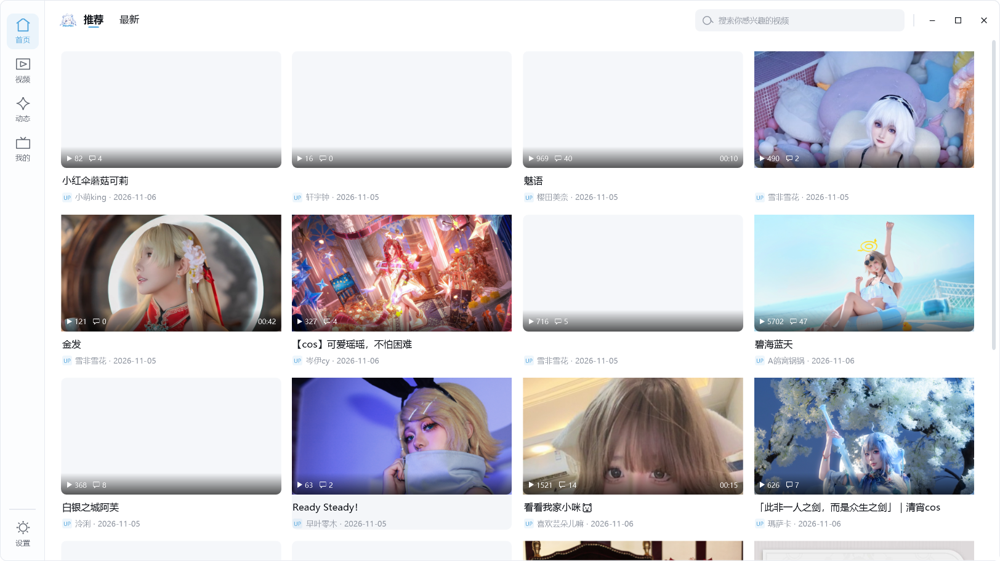

# MikoMiko

> 当前版本 **0.1.3** · 主色 **#4EA4DD（米蓝）**

一个基于 **WPF (.NET 8)** 的米游社第三方桌面客户端，界面参考 [TeyvatGuide](https://github.com/BTMuli/TeyvatGuide) 的「米游社」板块，账号页参考 [Starward](https://github.com/Scighost/Starward)。

左侧竖排导航（首页 / 视频 / 动态 / 我的，左下设置），浅色卡片流。



## 功能

| 页面 | 说明 |
| --- | --- |
| 首页 | **全站随机帖子流**：随机版块 + 随机排序 + 随机翻页游标，4 列卡片；**向下滑动自动加载更多**；帖子（含视频帖）点击后**在软件内直接打开**：正文、图片、内嵌视频、点赞 / 收藏、评论与楼中楼 |
| 视频 | **抖音式整屏刷视频**：上下滑动直接切下一条，无相关推荐；未缓存时在线直链播放，失败自动落盘缓存重试；只保留米游社原生按钮（点赞 / 收藏 / 分享），绑定 Cookie 后同步到账号 |
| 动态 | **只展示登录后关注的人**的动态；未登录显示扫码登录引导 |
| 我的 | 默认未登录，**米游社扫码（WebView2）登录**后才刷新昵称、头像、等级、统计、游戏与收藏；另有 Cookie 备用绑定 |
| 设置 | 整页可滚动展示全部设置；常规设置、**页面配色（米蓝 / 原青 / 星金 / 绝黄 / 崩2橙 / 崩3蓝 / 未定冷 / 萝莉粉 / 御姐紫 / 胡桃红）**、语言（简中 / 繁中 / English / 日本語 / Русский / 한국어）、字体、下载/缓存/播放、通用设置、应用维护、应用信息、关于、开源说明、免责声明、更新日志 |

其它能力：

- 无边框窗口（`WindowChrome` + Win11 圆角），自定义标题栏的最小化 / 最大化 / 关闭
- 浅色 / 深色主题实时切换（运行时替换 `Palette.*.xaml`）
- 十套主题色实时切换（`ThemeService.ApplyAccent` 覆盖 `Brush.Accent*`）
- 三种语言运行时切换
- 关闭行为可选：最小化到托盘 / 退出 / 询问
- 设置持久化到 `%LOCALAPPDATA%\MikoMiko\settings.json`
- 接口失败自动回落到内置演示数据，离线也能浏览界面

## 更新日志

### v0.1.3（2026-11-22）
- 首页搜索改为「搜索你感兴趣的内容」，词条直接走米游社官方全站搜索，帖子覆盖所有板块
- 首页随机流改为跨板块取样，帖子可下滑加载
- 阅读器新增评论框与楼中楼回复，登录后发布评论会同步到米游社
- 视频页去掉「上下滑动切换视频」提示；进度条改为白色未加载 / 灰色已缓冲 / 米蓝已播放
- 视频流改为全站所有用户的随机视频，点击左侧「视频」即刷新一批
- 修复扫码登录：兼容新版 `ltoken_v2` / `cookie_token_v2` Cookie，登录态持久化保存
- 离开视频页自动暂停播放与进度刷新
- 设置右侧新增目录跳转；移除下载目录；缓存每 5 分钟自动清理；更新日志改为抽屉式并加入颜文字
- 应用信息改为名称 / 版本 / 框架 / 数据目录，可打开或更改数据目录
- 修复关闭窗口时托盘图标资源缺失导致的未处理异常

### v0.1.2（2026-11-22）
- 左上角换成横向「MikoMiko」蓝色泡泡字 logo，移除原图标
- 首页帖子在软件内打开：正文 / 图片 / 视频 / 点赞收藏 / 评论与楼中楼，数据来自米游社官方接口
- 首页视频帖也在首页内播放，不再跳转视频页
- 修复视频无法播放：在线直链失败时自动下载到本地缓存再播放，支持边下边缓冲提示
- 视频页改为整屏抖音式：去掉相关推荐与信息区，下滑直接切下一条
- 动态仅显示已关注用户内容，未登录显示登录引导
- 「我的」默认未登录，米游社扫码（WebView2）登录后刷出账号信息
- 设置整页可滚动，栏目顺序重排
- 语言新增日本語 / Русский / 한국어
- 评论接口补齐 `is_hot`，修复评论加载

### v0.1.1（2026-11-22）
- 主色调整为米蓝 `#4EA4DD`（RGB 78, 164, 221）
- 新增十套页面配色：米蓝、原青、星金、绝黄、崩2橙、崩3蓝、未定冷、萝莉粉、御姐紫、胡桃红
- 首页改为全站随机帖子流，下滑自动加载更多随机帖子
- 视频页改为上下滑动切换随机视频，移除「投币」，只保留米游社原生点赞 / 收藏 / 分享
- 点赞与收藏在绑定 Cookie 后同步到米游社账号
- 封面加载失败自动使用兜底图，不再出现空白卡片

### v0.1.0
- 首个可用版本：五个页面、播放器、主题/语言/字体切换、托盘、设置持久化


## 环境要求

- Windows 10 1809 及以上
- [.NET 8 SDK](https://dotnet.microsoft.com/download/dotnet/8.0)
- Visual Studio 2022（安装 **「.NET 桌面开发」** 工作负载，含 .NET 8 目标包）

## 构建与运行

已提供安装包：`dist/MikoMiko-Setup-0.1.2.exe`（NSIS 制作，安装到 `%LOCALAPPDATA%\Programs\MikoMiko`，单用户安装、无需管理员，自动创建开始菜单与桌面快捷方式，可在「设置 → 应用维护 → 卸载」或控制面板卸载）。

Visual Studio：

1. 打开 `MikoMiko.sln`
2. 还原 NuGet 包（唯一依赖：`CommunityToolkit.Mvvm 8.2.2`）
3. F5 运行

命令行：

```powershell
dotnet build MikoMiko.sln -c Release
dotnet run --project src/MikoMiko/MikoMiko.csproj
```

首次启动会联网请求米游社公开接口；若被限流/断网，会自动使用内置演示数据，并把状态标示为「演示数据」。

## 项目结构

```
MikoMiko/
├─ MikoMiko.sln
├─ LICENSE
├─ docs/shots/            各页面渲染截图
└─ src/MikoMiko/
   ├─ App.xaml(.cs)        启动、主题/语言初始化、单实例
   ├─ GlobalUsings.cs      WinForms/WPF 同名类型别名
   ├─ Assets/              图标、logo、演示素材
   ├─ Controls/            AsyncImage（异步图片）、AdaptiveGridPanel（自适应列数）
   ├─ Converters/          值转换器
   ├─ Localization/        Loc 三语字典
   ├─ Models/              FeedItem、MomentItem、GameAccount、UserProfile、AppSettings …
   ├─ Services/            设置、主题、字体、图片缓存、米游社 API、内容聚合、演示数据
   ├─ Themes/              Palette.Light/Dark.xaml、Styles.xaml
   ├─ ViewModels/          Shell / Home / Video / Moment / Mine / Settings / PostDetail
   └─ Views/               MainWindow、五个页面、帖子详情窗口
```

## 数据来源

使用的米游社公开接口（只读，均需 `User-Agent` / `Referer` / `Origin` 请求头）：

- `bbs-api-static.miyoushe.com/apihub/wapi/webHome` —— 首页推荐流
- `bbs-api.miyoushe.com/post/wapi/getForumPostList` —— 板块帖子
- `bbs-api.miyoushe.com/post/wapi/getPostFull` —— 帖子详情、视频直链
- `bbs-api.miyoushe.com/user/wapi/getUserFullInfo` —— 用户信息

本项目与米哈游 / 米游社官方无任何关联，接口可能随时变更。

## 开发调试

```powershell
# 渲染指定页面为 PNG（开发调试用）
MikoMiko.exe --shot Home  docs\shots\Home.png
```

## 许可证

[MIT](LICENSE)
