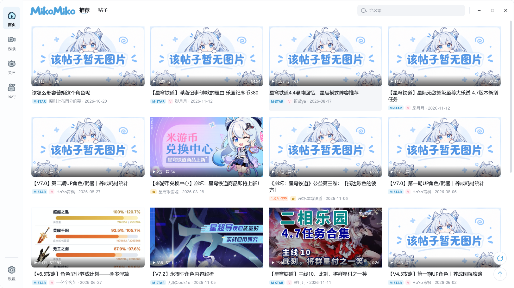

# MikoMiko

> 当前版本 **0.1.71** · 主色 **#4EA4DD（米蓝）**

一个基于 **WPF (.NET 8)** 的米游社第三方桌面客户端，界面参考 [TeyvatGuide](https://github.com/BTMuli/TeyvatGuide) 的「米游社」板块，账号页参考 [Starward](https://github.com/Scighost/Starward)。

左侧竖排导航（首页 / 视频 / 关注 / 我的，左下设置），浅色卡片流。



## 功能

| 页面 | 说明 |
| --- | --- |
| 首页 | **推荐 / 板块 / 网页 / 追番·影视** 四个页签；帖子分区筛选与 4 列卡片流，向下滑动自动加载更多；帖子（含视频帖）点击后在软件内直接打开 |
| 追番/影视 | 首页页签与独立入口共用；顶部为银发少女横幅；内置 7 部番剧与 10 场音乐会，点击即可在软件内播放，播放失败只在软件内提示、不跳网页 |
| 视频 | **抖音式整屏刷视频**：上下滑动或 `W/S`、方向键切下一条；`Q` 点赞 / 取消，`E` 收藏 / 取消；**本机 Range 代理边缓冲边播放**，进度条可拖动；底部恢复弹幕输入与发送，弹幕仅保存在本机；支持全屏播放 |
| 关注 | **只展示登录后关注的人**的动态；卡片可点入阅读器评论，右下角提供刷新与返回顶部 |
| 我的 | **应用内嵌官方通行证二维码登录**，登录后展示蓝色横幅个人主页；支持自定义背景、恢复默认背景；角色管理可点开对应游戏详情与帖子 |
| 设置 | 单列分区排版，右侧目录点击同步选中；常规、配色、字体、启动方式、缓存与下载位置、应用维护、应用信息、免责声明、更新日志 |

> 0.1.7 起左侧导航顺序为首页、视频、关注、我的，入口 key 仍为 `Moment`。

其它能力：

- 视频推荐：普通作者 1 天内不重复，官方视频按 BV / 帖子 2 小时内不重复，重启后仍生效
- 无边框窗口（`WindowChrome` + Win11 圆角），自定义标题栏的最小化 / 最大化 / 关闭
- 浅色 / 深色主题实时切换（运行时替换 `Palette.*.xaml`）
- 十套主题色实时切换（`ThemeService.ApplyAccent` 覆盖 `Brush.Accent*`）
- 界面固定简体中文，不再运行时切换语言
- 关闭行为可选：最小化到托盘 / 退出 / 询问
- 设置持久化到 `%LOCALAPPDATA%\MikoMiko\settings.json`
- 接口失败自动回落到内置演示数据，离线也能浏览界面

## 更新日志

### v0.1.71（2026-11-28）
- 追番/影视：去掉所有外部浏览器与网页跳转，推荐、线路和选集全部在软件内解析播放，失败只在软件内提示
- 启动页：左下角新增当前游戏的资讯卡片轮播，鼠标悬浮显示上一张 / 下一张按钮，切换游戏同步换内容
- 设置：更新日志改为简版，每版两三句、带颜文字，版本之间用横线隔开
### v0.1.70（2026-11-28）
- 源初之结：预约页去掉 slogan 图，只保留 logo、介绍、标签与 8 张宣传图轮播
- 启动页：Varsapura 接入软件内介绍页，使用随包 logo 与 9 张宣传图轮播，展示游戏介绍与标签
- Varsapura 页主按钮改为「第三方介绍」，点击跳转 `https://varsapura.city/`
### v0.1.69（2026-11-28）
- 抽卡记录：所有卡池固定排在同一排，不再折到下面；窗口不足时保持可读卡宽并横向滚动
- 启动页：「雨之城」文本改为「Varsapura」
- 源初之结：新增软件内预约页，使用随包 logo、slogan 与 8 张宣传图轮播，并展示介绍、标签和预约按钮
### v0.1.68（2026-11-28）
- 抽卡记录：星穹铁道去掉「新手跃迁」，只保留群星 / 角色活动 / 光锥活动 / 联动角色 / 联动光锥 5 个卡池
- 抽卡记录：全部游戏改为自适应分列，卡池多时自动折行；崩坏3 的 8 个补给卡池排成 4×2，不再藏到右侧
- 预约页：视频进度条、前后切换箭头改为鼠标悬浮在视频区域时显示，移开后只保留画面
### v0.1.67（2026-11-28）
- 内置网页：顶部去掉网页地址栏，只保留后退、刷新与关闭
- 启动页：点击「上传」时隐藏启动页 WebView，上传弹层不再被盖住，底色改为浅色避免露黑屏
- 抽卡记录：卡池卡最小宽度降到 170，崩坏3 的 8 个补给卡池（家园 / 扩充角色 / 精准 / 扩充装备 / 装备 / 人偶 / 进阶 / 活动）同排完整显示
- 预约页：整页改为 MikoMiko 浅色米蓝配色
- 预约页：关闭或点「预约」跳转时暂停、卸载视频并销毁 WebView2，退出后不会继续播放声音
### v0.1.66（2026-11-28）
- 抽卡记录：去掉记录行上方的滑块，保留按住鼠标左键拖动整列记录上下查看
- 启动页：「米哈云游」按钮固定在软件内浏览器打开 `https://mhyy.mihoyo.com/`
- 启动页：预约游戏里的「星布谷地」与「崩坏：因缘精灵」改为打开官方启动器同款预约页，含视频轮播、简介、标签与预约按钮；其他预约游戏仍打开官网
- 启动页：修复启动页自己的 WebView 压住软件内网页/预约页，导致点击后看起来没有反应的问题
### v0.1.65（2026-11-28）
- 抽卡记录：记录行不再显示 `/90`、`/80` 等目标值，只保留当前抽数；保底进度条仍按该卡池目标计算
- 抽卡记录：每条记录列表上方新增滑块，可拖动控制记录前后移动；记录区支持按住鼠标左键上下拖动
- 抽卡记录：点击「更新记录」前先检查对应游戏是否正在运行，且最近 15 分钟内打开过抽卡记录页；未打开时弹出「请在游戏内打开抽卡记录」，3 秒后自动关闭提醒

### v0.1.64（2026-11-28）
- 抽卡记录：修复每条记录下方的 5★ 保底进度条目标值不准。不再对所有卡池统一按 90/80/100 计算，改为按各卡池官方保底分别设置
- 原神：常驻祈愿 / 角色活动祈愿 / 集录祈愿 90 抽，武器活动祈愿 80 抽
- 崩坏：星穹铁道：群星跃迁 / 角色活动跃迁 / 联动角色跃迁 90 抽，光锥活动跃迁 / 联动光锥跃迁 80 抽
- 绝区零：独家频段 / 常驻频段 90 抽，音擎频段 / 邦布频段 80 抽
- 崩坏3：家园补给 / 扩充角色补给 / 活动补给 / 人偶补给 / 进阶补给 100 抽，装备补给 60 抽，精准补给与扩充装备补给 50 抽 UP 保护、200 抽毕业
- 记录行右侧由单一数字改为「当前/目标」，如 `37/90`；卡池卡片下方标注该卡池的保底口径，鼠标悬停可看完整说明
- 5★ 平均改为按实际出货抽数（TopRows 的 Pity 均值）计算，不再用总抽数除以出货数

### v0.1.63（2026-11-28）
- 抽卡记录：修复绝区零记录只拉到前几条、账号明明有几百条记录却只显示 3 条的问题。绝区零接口固定每页返回 5 条，旧逻辑按「本页不足 20 条」判断结束，第一页就停止；现在改为按 `page + end_id` 持续翻页，直到列表为空或连续多页没有新记录
- 抽卡记录：绝区零卡池请求改用官方唯一识别的 `real_gacha_type`。旧实现传 `gacha_type` 时接口 `retcode=0` 但列表为空，导致常驻、独家、音擎、邦布频段大量记录读不到
- 抽卡记录：完善限流处理，遇到 `-110` 请求过频会按 1.2s / 2.4s / 3.6s / 4.8s 退避重试，避免中途断掉只剩半截记录
- 实测同一账号绝区零从 5 条恢复到 865 条（常驻 100、独家 372、音擎 38、邦布 355），原神 1228 条回归无变化

### v0.1.62（2026-11-28）
- 抽卡记录：修复打开绝区零、星穹铁道等游戏的抽卡历史后，软件仍按原神读取，更新出来的却是原神记录的问题。首次进入抽卡页会自动跟随最近在游戏内打开过抽卡记录的游戏，不再默认停在原神
- 抽卡记录：不再自动把当前选择切回「第一个有本地记录的游戏」。用户选择绝区零后，即使本地还没有绝区零记录，也不会在刷新时被改回原神
- 抽卡记录：优先读取游戏缓存里完整的 `getGachaLog` 请求，保留官方域名、authkey 与页面初始化参数；绝区零改用 `public-operation-common` 接口，解决旧 `public-operation-nap` 域名返回空记录
- 抽卡记录：构造分页请求前先清理缓存 URL 中残留的 `gacha_type/page/size/end_id`，避免被缓存里的 `size=5` 截断，只拿到前几条
- 抽卡记录：统一按 5★ / 4★ / 3★ 显示，修复绝区零、崩坏3、千星奇域活动颂愿的星级整体降一档（5★ 显示成 4★、4★ 显示成 3★、3★ 显示成 2★）；千星奇域常驻颂愿本身没有 5★，正常显示 4★ / 3★ / 2★

### v0.1.61（2026-11-28）
- 抽卡记录：修复游戏运行时点击「更新记录」读不到抽卡内容。游戏占用 webCache 文件时改用可共享删除的读取方式，不再因文件被锁定直接失败
- 抽卡记录：修复缓存里最后一条匹配是 `.js/.png` 静态资源时误判为无 authkey。现在会向前遍历所有匹配，只接受带 `authkey` 的抽卡页地址
- 抽卡记录：「更新记录」改为游戏缓存优先；缓存拉取失败后才用米游社账号换取 authkey，避免账号换取的 key 无效时完全拉不到记录
- 抽卡记录：本地没有记录、UID 显示「暂无UID」时不再被 UID 校验挡住，先读游戏缓存拉取，UID 从接口返回的记录自动回填；有缓存时不再先请求角色列表，避免登录态失效或接口慢把更新卡在加载层

### v0.1.60（2026-11-28）
- 安装器：修复「选择安装路径」页路径框底边被底部「所需空间」色条遮挡的问题，路径框四边完整闭合，路径文字与「浏览...」重新对齐
- 版本更新提示：整页替换为新的银发少女更新插画，保留关闭、忽略、更新三个可点击区域，版本号按检测到的最新版本动态覆盖，不再显示图内烘焙的 V1.8.0
- 抽卡记录：「导出 CSV」「记录目录」移入「记录设置」，新增「清理账号数据」，只清理当前游戏 + 当前游戏 UID 的本地记录并在清理前自动备份；顶部 UID 明确为游戏 UID
- 抽卡记录：原神、绝区零、星穹铁道、崩坏3 的限定卡池五星角色/武器新增金色「UP！」标记，并按各游戏常驻名单排除非 UP 条目

### v0.1.59（2026-11-28）
- 安装器：「选择安装路径」页整条重绘路径框，路径文字与「浏览...」使用相同字号和垂直基线，左右留白一致；新的路径框完整覆盖底图里的旧输入框，去掉双层边框叠影和文字错位
- 安装器：底部「所需空间 / 可用空间」行同步重绘，按安装包实际解压体积和目标磁盘实时可用空间显示，不再保留底图烘焙的固定数字

### v0.1.58（2026-11-27）
- 安装器：选择安装位置时，在所选目录下自动创建 `MikoMiko` 子文件夹，安装内容全部放在该文件夹内；已选路径本身以 `MikoMiko` 结尾时不再重复追加
- 安装器：选择安装路径页的路径输入框与「浏览」按钮恢复垂直居中，底部「所需空间 / 可用空间」改为按安装包实际体积与目标磁盘实时容量显示
- 安装器：禁止直接安装到磁盘根目录，避免把程序文件散落到盘符根目录

### v0.1.57（2026-11-27）
- 启动页：左上角「米哈云游」改为直接调用软件内浏览器，打开 `https://mhyy.mihoyo.com/`
- 抽卡记录：全部卡池记录卡固定排在同一排，窗口变窄时保持卡宽并横向滚动；顶部 UID 使用游戏 UID；进入「千星奇域颂愿」后按钮文字变为「返回祈愿记录」，返回后恢复；点击「更新记录」时在页面正中播放透明背景 GIF 加载动画
- 设置：去掉账号头部右侧「退出登录」按钮

### v0.1.56（2026-11-27）
- 每日任务：修复极验「完成验证」后米游社打卡仍失败。严格对齐 TeyvatGuide 实用脚本：极验创建与校验使用 `stoken/stuid/mid` 的 X4 签名与 `x-rpc-client_type: 5`，`getValidate()` 原样提交并延后取值，打卡重试只携带 `x-rpc-challenge`
- 抽卡记录：UID 只显示对应游戏 UID，不再显示米游社 UID；没有记录时显示「暂无UID」；卡池卡片与记录区按窗口宽度自动分栏，窗口拉宽/收窄时同步重排
- 我的：移除右上角「退出登录」，切换账号浮层内每个账号右侧新增删除图标，删除当前账号后自动切到剩余账号
- 追番/影视：新增《原神》长期项目启动·概念PV 与《崩坏：星穹铁道》原创动画概念PV「死于午后」，点击后在软件内解析播放

### v0.1.54（2026-11-27）
- 修复每日任务极验验证成功后不返回、签到不继续：修正 WebView2 消息被二次 JSON 编码导致 `validate` 无法识别的问题，验证结果先交回任务页再异步关窗，截图中的「验证成功」白屏不会再卡住；弹窗补充右上角关闭按钮
- 修复视频全屏右侧与底部仍露出桌面背景：解除 `WM_GETMINMAXINFO` 对窗口最大尺寸的限制，全屏窗口真正铺到显示器外扩 10px，避免只盖住左上、右下落出桌面
- 「追番/影视」移除原有全部番剧与音乐会内容，只保留《女武神的餐桌》第一季、第二季、《人偶学园》《黄金庭院：冬日里的新年愿望》《旅途危机！圣芙蕾雅号特别事件》五部【推荐】，点击后在软件内直接解析樱花TV 播放线路，解析失败再回退站点网页播放器

### v0.1.53（2026-11-27）
- 修复每日任务极验弹窗在点击「完成验证」后卡住：弹窗不再使用模态循环，收到验证结果后立即隐藏关闭并把结果交回任务页，继续校验与签到
- 修复视频全屏四边仍能看见桌面背景：全屏窗口按显示器物理边界向四周多铺 10px，把无边框窗口的非客户区与 DWM 阴影推到屏幕外，并在布局完成后再次校正

### v0.1.52（2026-11-27）
- 首页「板块」排序项「最新发布」改为「最新」；启动页下载/安装游戏时，主按钮内直接显示实时安装进度
- 「米哈云游」与预约游戏卡片补齐跳转：星布谷地、源初之结、因缘精灵、雨之城均可点击打开对应官网
- 视频页加入鼠标控制：移动鼠标显示标题、操作栏与进度控制，静止后自动隐藏；新增空格键暂停/继续
- 每日任务验证码弹窗精简为极验面板，验证完成自动关闭；重做验证结果整理与签名，修复「完成验证后打卡仍失败」
- 抽卡页去掉右上角三点菜单及其内容，记录区整体上移；游戏选择框前新增对应游戏图标
- 「我的合集」打开后点击其他区域或按钮会自动关闭；进入他人主页且没有合集时显示「TA还没有合集」
- 缓存管理改为左右两栏，下载位置移到缓存信息右侧
- 启动软件后自动检查更新，发现新版本时弹出更新提示

### v0.1.51（2026-11-27）
- 启动页下载游戏时不再在页面显示「正在写入：xxx」等文件级信息，只在鼠标悬浮下载按钮的悬浮卡中显示下载/安装双进度、剩余时间与实时速度
- 修复视频右下角最大化后四周出现白边的问题，同时清理无边框全屏下的窗口 resize 边框与背景
- 抽卡页去掉当前记录条数；游戏、UID、更新记录、记录设置、导出与记录目录收进右上角同一排，并重做游戏/UID 下拉框
- 记录概览与出货分析改为覆盖在记录区上方的浮层，展开时不再把下方记录整体挤下去
- 抽卡页禁止整页纵向滚动，只允许单个卡池内部的记录列表滚动
- 每日任务验证码改为拿到极验结果后立即关闭弹窗，再由任务页提交校验，点击验证不再卡住；弹窗新增独立标题栏与关闭按钮
- 设置页「通用设置」并入「应用维护」；「应用信息与关于」更名为「应用信息」，内容调整为关于在上、版本与数据目录在下

### v0.1.50（2026-11-27）
- 修复每日任务验证码在显示「验证成功」后卡住不动的问题，成功即关闭弹窗，超时会自动刷新验证码
- 启动页安装卡去掉写入信息，鼠标悬浮提示不再显示写入量，进度条改为米蓝 `#4EA4DD`
- 启动页「定位游戏」前新增「已安装？立即定位→ 」提示
- 首页空态文案改为「未找到本地游戏，点「获取游戏」即可立即安装。」
- 抽卡页把游戏、UID、更新记录等工具和记录概览、出货分析统一移到右上角；概览与分析默认收起，可点击展开
- 抽卡记录随窗口宽高自由自适应，按可视宽度均分卡池列
- 「我的合集」改为在软件内打开合集阅读器，点击条目直接进入帖子阅读器
- 设置页把「应用信息」与「关于」合并，放宽长文本排版减少提前换行
- 缓存管理改为「运行期间每1小时自动清理一次过期缓存文件。」
- 首页板块选择框加入九款游戏图标（大别野、崩坏学园2、崩坏3、未定事件簿、原神、星穹铁道、绝区零、星布谷地、因缘精灵）

### v0.1.49（2026-11-27）
- 应用内更新改为静默安装到当前目录，安装完成后自动重启
- 启动页游戏设置恢复「预约游戏卡片」「米哈云游按钮」的显示与不显示
- 抽卡记录页改用软件主题配色，概览与出货分析移到上方、全部卡池记录整排置底
- 每日任务验证码弹窗压缩到九宫格与底部操作，去掉多余说明和空白
- 修复「我的合集」里创建的合集无法点击打开
- 设置页改为单列排列，缓存管理、应用信息等不再左右并排

### v0.1.48（2026-11-27）
- 设置页移除语言切换入口，界面固定使用简体中文
- 启动页游戏设置移除「启动页显示」自定义开关与「官方启动器壁纸」选择区，只保留游戏信息、打开目录、重新定位和卸载

### v0.1.47（2026-11-27）
- 全部按钮加入果冻按压动效：悬停轻放大、按下压缩到 0.90、松开弹性回弹
- 语言切换补全：设置、抽卡、每日任务、我的与启动页 WebView 的硬编码文本都会跟随语言切换
- 修复英文界面反复刷新时把译文重新翻回中文的问题；繁体界面补齐 WebView 文本转换

### v0.1.46（2026-11-27）
- 追番/影视页把「全部 / 番剧 / 音乐会」叠到横幅左上、右侧新增「我追的」，横幅上加入搜索框，播放器视频右下角加入全屏按钮
- 视频与追番播放器全屏改为覆盖整块显示器，修复全屏后仍露出 Windows 任务栏
- 抽卡记录页按参考图重做为暗色三列祈愿记录页，支持从游戏缓存 authkey 拉取原神/星铁/绝区零/崩坏3 记录并合并本地库
- 极验验证窗口放大并支持滚动，修复九宫格选图后确认按钮被裁掉
- 启动页切回前台时强制重绘壁纸并恢复动态壁纸，修复背景偶发变黑
- 左侧「上传」图标与其它导航项对齐
- 设置账号卡片文案随语言即时刷新；切换语言时补翻弹窗、独立窗口与硬编码文案，繁体走系统简繁转换，英/日/俄/韩补齐英文回退
- 「我的」切换账号弹窗固定显示在按钮右侧

### v0.1.45（2026-11-27）
- 安装器新增目录选择页，用户可自选安装位置；升级时默认带出注册表里上一次的安装目录
- 「追剧/影视」改名「追番/影视」并重排版：去掉营销徽标、作品数量、在线播放等文案，底部状态栏收进页头过滤行
- 直连流解析失败时直接显示播放失败，不再跳转站内网页播放
- 启动页只保留官方启动器同步下来的壁纸，移除内置占位图与自定义背景入口
- 每日任务验证码参考 TeyvatGuide 实用脚本页，改为软件内直接创建极验并显示滑块，成功后带 `x-rpc-challenge` 重试签到
- 「我的」切换账号浮层重做：顶部「添加新账号」，下方列出头像、用户名与米游社 UID，并标记当前账号
- 左侧「上传」导航图标换成蓝底白色四角星
- 设置页卸载先拉起独立卸载器再退出主程序，卸载器内兜底结束残留进程，保证卸载干净

### v0.1.43（2026-11-26）
- 启动画面改为整张「少女探头 + MikoMiko」海报，不再叠加动画与进度文案
- 首页初始加载 / 加载更多、视频缓冲、网页页、追番模块、播放器、动态、帖子详情与浏览器统一接入 MikoMiko 加载 GIF
- 抽卡记录页仿 MikoNest 重做：262 宽卡池卡、顶部 accent 线与 96px 淡彩 wash、四行统计、5★/4★ 分段、平铺记录行（rank 软色底、26px 渐变徽标、UP 标签）与保底进度条
- 抽卡设置新增「记录区显示 4★」「显示条目图标」，底部新增状态卡；账号选择改为 UID，保底按 UID 分段累计

### v0.1.42（2026-11-26）
- 启动画面改为「少女探头 + MikoMiko 动态 Logo」的加载动画，使用透明 GIF 逐帧播放，启动时能看到品牌字与进度线循环

### v0.1.41（2026-11-26）
- 安装、卸载、安装完成、更新提示与启动画面全部换成萌系蓝白少女视觉：白发双马尾 Q 版角色、浅蓝渐变、圆角卡片与星星装饰
- 首页页签改为推荐 / 板块 / 网页 / 追剧·影视，追剧从左侧导航收进首页
- 视频页恢复弹幕输入、发送与本机存储，新增全屏播放；追剧播放器移除弹幕并改为深蓝配色
- 抽卡页四卡池等分铺满，记录卡改为米黄卡片与分段垫抽条；每日任务与「我的」自动同步当前账号
- 启动页游戏设置改为同排布局并支持官方壁纸选择；默认启动进入启动页面，下载目录默认放在安装目录下

### v0.1.40（2026-11-26）
- 视频作者冷却改为 1 天，官方视频按 BV / 帖子 2 小时内不重复；下载过程中的文本提示统一 3 秒后自动消失
- 新增 `Q/q` 点赞与取消、`E/e` 收藏与取消、`W/w/↑` 上一个、`S/s/↓` 下一个；移除视频发弹幕输入
- 启动页安装配置点击「开始安装」后自动关闭，主按钮原位显示可暂停 / 继续的进度；「取消安装并清理」会删除本次写入的目录
- 安装软件期间预置启动页壁纸与兜底图，首次打开启动页无需等待
- 「追剧/影视」改为左侧独立导航页，顶部加入银发少女横幅；首页只保留推荐 / 板块 / 网页三个页签

### v0.1.39（2026-11-25）
- 抽卡记录页新增统计总览、设置面板与底部状态栏，卡池卡片与记录列表重新排布
- 每日任务遇到验证码 1034 时在软件内弹出安全验证窗口并自动重试
- 首页新增「追剧/影视」页签，内置 7 部番剧与 10 场音乐会，点击即可在软件内播放，直连失败自动切换站内网页播放

### v0.1.32（2026-11-25）
- 「追剧/影视」首页按设计稿重做：顶部居中搜索栏、整幅蓝白横幅、猜你喜欢与七列海报墙
- 修复选集后无法观看视频：Flutter 与宿主改为消息队列轮询通讯，选集与开始播放的指令能真正送达播放器
- 直连流 6 秒内取不到或播放器报错时，自动在软件内打开站点原播放页，不再只弹“取不到视频流”
- 站点播放页 12 秒仍未打开时给出超时提示，可返回换来源或改用系统浏览器
- 播放器新增「网页播放」入口，随时可切到站点页面

### v0.1.31（2026-11-25）
- 首页「板块」分区下拉的游戏名前添加角色头像图标：原神（派蒙）、崩坏3（琪亚娜）、崩坏：星穹铁道、绝区零（安比）

### v0.1.30（2026-11-25）
- 首页顶部页签「帖子」改为「板块」，内部标识保持不变
- 首页推荐流同一作者至少间隔 20 条帖子，首屏 20 条来自 20 个不同作者，下滑加载继续维持间隔
- 「视频」同一官方账号至少间隔 1 小时再次推送，普通作者保持 3 天冷却，同批次内作者不重复
- 「追剧/影视」内置规则替换为樱花动漫1、樱花TV、PIDEC、南瓜电影、七猫视频、电影先生、漫漫看、麻花影视八站
- 八站规则按公开页面结构适配；南瓜电影、七猫视频依赖前端动态接口，部分搜索或详情存在安全验证，仅能抓取站点允许公开访问的内容

### v0.1.29（2026-11-25）
- 修复扫码登录失败（Cookie 无效）：改用 App 端 createQRLogin / queryQRLoginStatus 接口，确认后从 tokens 取 stoken，再走通行证 V2 换票接口换取 ltoken_v2 与 cookie_token_v2，不再依赖旧的 Set-Cookie 读取与已失效的 stoken 升级 / 直连换票接口
- 米游社版本号对齐 2.119.0，换票请求使用通行证 SDK 2.44.0 签名头
- 首页「帖子」分区下拉的游戏名前新增小图标：原神、崩坏3、崩坏：星穹铁道、绝区零

### v0.1.23（2026-11-25）
- 「追番/影视」整体重做为 Flutter 规则采集模块，类似 Kazumi：自定义规则、番剧目录、搜索、分集播放
- 规则引擎支持最多五行 XPath 选择器构建采集规则，覆盖搜索列表、结果名称、结果链接、章节线路与章节链接
- 支持 Kazumi 规则 JSON 导入、规则编辑、启用 / 停用、分享复制与全部规则导出
- 内置七色番、Aafun、AkiAnime、白猫、MXdm、DM84、Xfdmneo 七条规则，首页按规则抓取站点最新
- 播放器新增 Anime4K 实时超分开关，WebGL2 自适应边缘锐化并保留自定义播放控制条

### v0.1.22（2026-11-24）
- 「追番/影视」搜索改为先访问各站点公开检索，取到结果后再同步到站内，哔哩哔哩番剧与影视也纳入搜索
- 新增「片库」筛选，覆盖电影、电视剧、短剧、动漫、日漫、日韩漫画、国漫、欧美动漫、其他动漫、动漫电影、中国港澳台动漫、综艺，直连指定站点列表
- 播放器当前线路无法提取视频时自动检索并切换其他站点，尽量保持同一集序号
- 播放器新增弹幕层与发送框，弹幕按作品和集数本地保存，换站或换线路后同集弹幕自动同步

### v0.1.21（2026-11-24）
- 「追番/影视」首页横幅换成新的银发少女原图，首页下滑可持续加载更多海报
- 播放器新增「查询网站」区，可在播放线路与选集上方自由切换九个站点重新查询来源
- 搜索框输入关键词即直接展示搜索结果，不再先铺满全部内容
- 「查看全部」右下角可随时刷新；切换类型或风格会重新访问数据源查询
- 左上角新增「我的追剧」，播放器点击追剧后实时同步收藏并持久保存
- 右下角改为纯图标刷新与回顶按钮，界面不出现文字标签

### v0.1.20（2026-11-24）
- 「追番/影视」未下载页改为用户提供的整幅原图居中展示，不裁切、不重绘，胶囊按钮可直接下载模块
- 追番首页按新效果图重做：顶部白色搜索栏、整幅蓝白少女横幅、猜你喜欢七列海报，每次进入随机换一批
- 「查看全部」新增类型、排序、地区、风格四行筛选与七列海报；修复部分站外海报因 Referer 限制加载失败
- 点击作品进入 B 站式播放页：左侧视频、右侧简介 / 追剧 / 播放线路 / 选集网格，可自由切换线路与剧集，当前集高亮
- 离开追番/影视页时自动关闭播放器并释放 WebView2，停止播放与音频；返回首页时随机内容自动刷新
- 修正模块数据源编号：樱花动漫1 为 zhuidm、樱花动漫2 为 yinghdm，模块版本升至 1.3.0

### v0.1.19（2026-11-24）
- 「追番/影视」未下载页严格使用设计原图，不再自行绘制；大胶囊按钮可直接点击下载模块
- 追番/影视播放改为在软件内解析真实视频流，内置 HLS / MP4 播放器直接播放，不再展示或跳转第三方站点网页
- 修复「视频」评论区点击正文无法回复他人评论的问题
- 「我的发布 / 我的评论 / 我的合集 / 我的收藏」内容卡去掉鼠标悬浮时的蓝色底色
- 设置页「关闭主界面时」默认选择「最小化到系统托盘」，缓存 / 应用信息与通用 / 维护卡片重排为等高对齐

### v0.1.18（2026-11-24）
- 「追番/影视」首页按效果图重排：顶部悬浮搜索框、满幅 Hero 与右下播放按钮、底部七格今日更新横排、左侧分类栏与七列猜你喜欢海报墙
- 修复扫码登录 -100：改用网站扫码接口并从确认响应头 `Set-Cookie` 读取完整凭证；账号校验优先走社区资料接口，不再被绑定接口误判失效
- 设置页统一卡片宽度与左右边界，应用维护 / 应用信息、关于 / 免责说明逐行等高，开源说明通栏铺满并与上方卡片对齐

### v0.1.17（2026-11-24）
- 「追番/影视」未下载页按新视觉重做：白底浅蓝软装饰、软萌角色探身指向大号胶囊下载按钮，页面只保留下载入口，不显示顶部搜索框与站点网页链接
- 搜索框、左侧分类与原生影视首页仅在模块下载完成后出现；卸载模块后自动回到下载页
- 追番/影视正式聚合樱花动漫1、樱花动漫2、樱花TV、PIDEC、南瓜电影、七猫视频、电影先生、漫漫看、麻花影视九个站点
- 影视首页为搜索栏 + 左侧分类 + 大图 Hero + 今日更新横排 + 猜你喜欢海报墙；作品详情与播放全部在软件内完成
- 上传网页恢复完整原样，不再隐藏站点 logo、导航与搜索框；软件登录态仍会同步注入

### v0.1.16（2026-11-24）
- 「追番/影视」未下载模块时只保留一个下载按钮，隐藏顶部搜索框与底部站点链接；下载后自动进入原生影视首页
- 影视首页重做为搜索栏 + 左侧分类 + 大图 Hero + 今日更新横排 + 猜你喜欢海报墙，支持国产 / 日韩 / 欧美 / 动画 / 港台 / 海外 / 综合 / 今日更新 / 热榜 / 资讯
- 聚合樱花动漫1、樱花动漫2、樱花TV、PIDEC、南瓜电影、七猫视频、电影先生、漫漫看、麻花影视九个站点
- 作品详情与视频播放全部在软件内完成，播放页隐藏地址栏并自动清理常见浮层广告，不跳转系统浏览器
- 搜索支持站内跨源检索与本地缓存兜底；修复第三方封面被固定 Referer 拦截的问题

### v0.1.15（2026-11-24）
- 帖子视频进度条支持拖动到任意位置即时缓冲，播放期间控制栏常驻
- 帖子与视频评论区点赞爱心变红；帖子标题、正文、一级评论与楼中楼文本均可鼠标选中复制
- 视频评论区单击评论即可回复；点击头像或昵称进入用户主页；点击评论面板外任意位置关闭评论区
- 视频清晰度切换真实作用于播放源；下载成功后保存位置提示只显示 1 秒；发送按钮右侧新增「弹幕功能仅能自娱自乐。」
- 关注页动态中的头像与昵称可直接进入用户主页
- 我的页「我的发布 / 我的评论 / 我的合集 / 我的收藏」移除悬浮效果
- 上传网页恢复完整原样，不再隐藏站点 logo、米游社文字、导航与搜索框；登录态仍会同步注入
- 软件登录态同步注入发布网页；设置页新增开源说明并优化排版

### v0.1.14（2026-11-24）
- 帖子评论区新增「默认 / 最新」排序；点赞爱心变红，点踩后图标变灰并折叠该评论，取消踩恢复
- 评论头像与昵称可直接进入用户主页，楼中楼同样支持
- 视频点赞数字即时 +1 / -1；视频评论区补齐排序、回复、图片灯箱与右下角下载
- 关注页全部动态按发布时间倒序，最新置顶；点击动态中的用户，右侧只显示 TA 的全部内容
- 我的页角色管理设置移除「显示游戏战绩详情」；更换背景的预览区用斑马线标记显示范围
- 上传网页隐藏站点 logo、米游社文字、首页 / 校园 / ACG 导航和搜索框，仅保留右上角头像登录
- 发布内容九个板块替换为对应板块插画；设置页改为两列等宽卡片排版

### v0.1.13（2026-11-24）
- 视频随机流作者冷却由 7 天调整为 3 天，3 天内不再推送同一作者，到期自动清理；官方视频不受冷却限制
- 首页新增「追番/影视」板块，可独立下载与卸载，聚合樱花TV、PIDEC、樱花动漫、南瓜电影、七猫视频、电影先生、漫漫看、麻花影视等九个站点
- 「推荐 / 帖子 / 追番/影视」选中文字改为 `#4EA4DD` 蓝色；进入追番/影视后隐藏页头全局搜索，只保留板块内搜索
- 新增影视首页与「查看更多」多维筛选，支持类型、排序、地区、来源筛选，海报显示集数与完结状态
- 关注页「全部动态」图标改为淡蓝色，移除用户头像右侧红点
- 设置更新日志移除作者徽标相关记录，每个版本之间新增分隔线

### v0.1.12（2026-11-24）
- 视频随机流新增作者冷却：实际刷到的作者记录 UID 与用户名，7 天内不再推送同一作者，到期自动清理记录
- 视频随机池改为并行关键词搜索 + 多版块并行补足，减少串行等待，随机覆盖更多作者与旧投稿
- 关注页改为左侧关注用户导航 + 右侧动态流，可在「全部动态」与单人动态间切换，红点标记有动态的 TA
- 设置上方新增蓝底白星上传入口，先选 9 个板块，再选长文 / 图片 / 视频，直达米游社对应发布页

### v0.1.11（2026-11-23）
- 认证 V 改为淡粉 `#F0A9BD` / `#FFF1F5` 底；灰岁Huiusto（通行证 310621322）不再显示 V，仅保留身份标识
- 首页 / 视频 / 我的导航默认图标重绘为与关注、设置一致的蓝灰双色轮廓
- 视频页进度条固定 3px，新增可拖动的白色圆点，去掉靠近变粗与焦点边框，交互参考 B 站
- 用户主页顶部换用冰蓝发少女横幅；发布跨全部版块分页拉取，包含视频与图文；TA 的游戏角色显示游戏 UID，点击角色卡可查看对应游戏战绩详情
- 修复视频评论区楼中楼回复与点赞命令绑定错误，子评论可直接回复
- 关注流改为按账号级完整关注列表逐人拉取全版块最新帖子，不再只限原神版块
- 我的 → 角色管理设置新增「显示游戏战绩详情」开关，关闭后点击角色卡给出提示
- 搜索相关用户默认只显示两排，右侧新增「更多用户」展开全部
- 首页推荐及空搜索不再出现「相关用户」，仅有关键词搜索时显示
- 帖子视频控制栏改为悬停显示 / 移出隐藏，播放暂停改用白色图标，点击画面可切换播放；灯箱下载按钮只保留图标
- 设置页移除窗口设置，重排缓存、通用、应用维护卡片

### v0.1.10（2026-11-23）
- 关注 / 设置导航默认图标与选中态同轮廓、同粗细、同尺寸，去掉默认态的扁平差异
- 搜索移除用户 / 攻略 / 视频 / 百科 / 图片 / 话题分类文本，直接展示相关用户与综合内容
- 个人认证作者显示粉红色 V；灰岁Huiusto（通行证 310621322）保留 M-STAR 并追加淡紫色 MikoMiko，用户主页显示淡紫色 M
- 评论发送与回复改为网页端 2.102 签名并对齐参数，顶层评论不再传 reply_id，修复 invalid request
- 视频清晰度按钮移至倍速旁；进度条取消悬停变化，拖动到落点即从该处缓冲；点赞 / 收藏不再重载视频，未登录提示「请登陆账号」
- 我的角色管理改为三列，标题前新增齿轮设置，可隐藏游戏、调整顺序并持久化；六枚游戏图标换成官方图标
- 用户主页补齐米游社 UID、全部可用标签、认证徽标、发布 / 评论 / 合集 / 收藏四页签、用户内容搜索与游戏角色
- 设置页新增页标题，分区卡片改为自适应高度，收紧间距与留白
- 帖子内视频支持点击画面或控制栏按钮暂停 / 播放，进度条可自由定位

### v0.1.9（2026-11-23）
- 左侧「关注 / 设置」导航图标默认态与选中态统一尺寸；个人认证作者在 M-STAR 后追加红色 V，视频作者按身份显示金色官、红色 V 或开发者蓝色 M
- 设置顶部新增 GitHub 项目主页（系统浏览器）与开发者首页（软件内打开），移除关于区旧外链；登录后账号按钮改为「前往我的主页」
- 移除窗口大小选择与播放设置；新增下载位置设置，可更改与直接打开，帖子图片 / 视频、视频页均支持下载到该目录
- 视频推荐随机混合官方与用户作品，同一作者 5 条内不重复；评论改为 App 通道签名修复 invalid request；评论作者色统一 #4EA4DD
- 帖子内视频新增可拖动进度条、时间与下载；图片灯箱新增左右翻页按钮、页码与下载
- 我的页角色卡直接展示各游戏公开战绩与游戏图标并取消悬浮；发布 / 评论 / 合集 / 收藏合并为一栏切换按钮
- 搜索页新增综合 / 攻略 / 视频 / 百科 / 图片 / 用户 / 话题分类页签
- 关注页取消悬浮，可直接点赞与收藏；评论图片与表情正常加载
- 视频右上角新增三点菜单，可选画质并下载视频，进度条取消悬浮反馈
- 搜索框与视频弹幕输入框改为随机文案自动轮换

### v0.1.8（2026-11-23）
- 首页新增「推荐 / 帖子」切换与刷新、返回顶部入口；帖子流按分区与版块筛选
- 阅读器支持正文图片灯箱缩放拖动，帖子内视频可播放；评论输入框与楼中楼回复上线
- 用户主页可直接跳转，关注状态与官方同步
- 视频页支持画质、倍速、弹幕与评论抽屉；我的页支持自定义背景与发布 / 评论 / 合集 / 收藏
- 设置页重排并加入应用内更新日志抽屉；搜索优先展示相关用户

### v0.1.7（2026-11-23）
- 左侧导航换成新版灰线稿 / 米蓝选中图标，顺序为首页、视频、关注、我的，设置固定左下并统一对齐
- 首页「官方」改为「帖子」：新增分区、版块、排序三联筛选，覆盖大别野、原神、星穹铁道、崩坏3、未定事件簿、绝区零、崩坏学园2、因缘精灵、星布谷地
- 帖内图片支持滚轮缩放，正文沿用官方富文本、字号颜色与话题标签，正文链接一律在软件内打开
- 首页帖子与关注页右下角新增刷新、返回顶部图标；关注页帖子可点入阅读器并评论
- 阅读器评论输入框加高为多行，评论 / 回复可发送；视频评论区支持回复与楼中楼「回复 @某人」
- 视频画质与倍速改为抽屉式选择，弹幕按钮控制显隐，点赞收藏有变色反馈并同步官方数据；修复视频页加载时因 SpeedRatio 绑定导致的崩溃
- 我的页去掉昵称右侧 Lv.0，新增恢复默认背景，修复第二次更换背景失效；角色卡片可打开对应游戏详情与帖子
- 设置页重排为单列分区，右侧目录点击同步高亮，账号信息实时同步，移除开源说明；顶部外链收进「关于」
- 启动页「首页 / 视频」改为互斥单选；检查更新发现新版本直接在软件内弹窗，可一键更新

### v0.1.6（2026-11-23）
- 左侧导航「动态」文案改为「关注」
- 左侧导航换成新的手绘图标：默认灰色线稿，选中时米蓝填充 + 深色描边
- 五个图标按首页 / 关注 / 视频 / 我的 / 设置对应，导航顺序同步调整为首页、关注、视频、我的

### v0.1.5（2026-11-22）
- 首页作者徽标区分 M-STAR、金色「官」与粉色 MikoMiko，新增「官方」内容标签
- 左侧导航改用圆润饱满图标；帖子阅读器去掉折叠，支持图片灯箱、内嵌视频拖动进度与正文链接
- 阅读器右下角新增回顶「火箭」和跳转评论区按钮；首页打开帖子后切换其他页面会自动关闭
- 视频页支持关注、点赞、收藏、评论数字与「发布页」，点击画面暂停 / 播放，进度条加粗可拖动
- 动态页按关注列表拉取新旧帖子，不再只显示最新动态
- 「我的」页刷新资料 / 退出登录按钮改为圆角并移到右上角，右下角支持自定义背景
- 设置页改为多列卡片布局，新增「启动时默认进入视频」「视频结束自动下滑」「下滑视频自动播放」
- 新增应用内检查更新、下载进度、安装器启动与忽略本次版本

### v0.1.4（2026-11-22）
- 设置顶部新增「访问项目主页（GitHub）」与「开发者首页（支持、讨论、问题反馈）」两个跳转按钮
- 首页帖子按官方 `structured_content` 富文本渲染：正文、图片、视频保持原顺序混排，长文与长图可折叠
- 视频改为本机 HTTP Range 代理边缓冲边播放，进度条新增可拖动圆点，播放数前显示作者关注数，去掉「第 1/12」序号
- 自动预加载后三个视频；右侧「收藏」下新增「评论」，同步视频帖评论，登录后可发表
- 修复暂停后画面停住但声音继续；「自动」按钮真实切换 1080P / 720P / 480P 并保持播放位置
- 弹幕可发送，按视频保存在本地 `danmaku.json`，并滚动回放本机用户发过的弹幕
- 登录改为应用内嵌通行证 App 二维码，扫码后自动换取 `cookie_token` / `ltoken`；改用 `getUserGameRolesByCookie` 校验登录态
- 「我的」按官方样式重做为蓝色横幅个人主页 + 角色管理
- 更新日志补齐 0.1.0 → 0.1.4 全部历史
- 增加单实例互斥，防止同机多开同时写设置与登录态导致数据错乱

### v0.1.3（2026-11-22）
- 首页搜索改为「搜索你感兴趣的内容」，词条直接走米游社官方全站搜索，帖子覆盖所有板块
- 首页随机流改为跨板块取样，帖子可下滑加载
- 阅读器新增评论框与楼中楼回复，登录后发布评论会同步到米游社
- 视频页去掉「上下滑动切换视频」提示；进度条改为白色未加载 / 灰色已缓冲 / 米蓝已播放
- 视频流改为全站所有用户的随机视频，点击左侧「视频」即刷新一批
- 修复扫码登录：兼容新版 `ltoken_v2` / `cookie_token_v2` Cookie，登录态持久化保存
- 离开视频页自动暂停播放与进度刷新
- 设置右侧新增目录跳转；移除下载目录；缓存每 5 分钟自动清理；更新日志改为抽屉式并加入颜文字
- 应用信息改为名称 / 版本 / 框架 / 数据目录，可打开或更改数据目录
- 修复关闭窗口时托盘图标资源缺失导致的未处理异常

### v0.1.2（2026-11-22）
- 左上角换成横向「MikoMiko」蓝色泡泡字 logo，移除原图标
- 首页帖子在软件内打开：正文 / 图片 / 视频 / 点赞收藏 / 评论与楼中楼，数据来自米游社官方接口
- 首页视频帖也在首页内播放，不再跳转视频页
- 修复视频无法播放：在线直链失败时自动下载到本地缓存再播放，支持边下边缓冲提示
- 视频页改为整屏抖音式：去掉相关推荐与信息区，下滑直接切下一条
- 动态仅显示已关注用户内容，未登录显示登录引导
- 「我的」默认未登录，米游社扫码（WebView2）登录后刷出账号信息
- 设置整页可滚动，栏目顺序重排
- 语言新增日本語 / Русский / 한국어
- 评论接口补齐 `is_hot`，修复评论加载

### v0.1.1（2026-11-22）
- 主色调整为米蓝 `#4EA4DD`（RGB 78, 164, 221）
- 新增十套页面配色：米蓝、原青、星金、绝黄、崩2橙、崩3蓝、未定冷、萝莉粉、御姐紫、胡桃红
- 首页改为全站随机帖子流，下滑自动加载更多随机帖子
- 视频页改为上下滑动切换随机视频，移除「投币」，只保留米游社原生点赞 / 收藏 / 分享
- 点赞与收藏在绑定 Cookie 后同步到米游社账号
- 封面加载失败自动使用兜底图，不再出现空白卡片

### v0.1.0
- 首个可用版本：五个页面、播放器、主题/语言/字体切换、托盘、设置持久化


## 环境要求

- Windows 10 1809 及以上
- [.NET 8 SDK](https://dotnet.microsoft.com/download/dotnet/8.0)
- Visual Studio 2022（安装 **「.NET 桌面开发」** 工作负载，含 .NET 8 目标包）

## 构建与运行

已提供安装包：`dist/MikoMiko-Setup-0.1.71.exe`（WPF 自绘安装器，安装时可自选目录并自动创建 `MikoMiko` 文件夹，单用户安装、无需管理员，自动创建开始菜单与桌面快捷方式，可在「设置 → 应用维护 → 卸载」或控制面板卸载）。

Visual Studio：

1. 打开 `MikoMiko.sln`
2. 还原 NuGet 包（唯一依赖：`CommunityToolkit.Mvvm 8.2.2`）
3. F5 运行

命令行：

```powershell
dotnet build MikoMiko.sln -c Release
dotnet run --project src/MikoMiko/MikoMiko.csproj
```

首次启动会联网请求米游社公开接口；若被限流/断网，会自动使用内置演示数据，并把状态标示为「演示数据」。

## 项目结构

```
MikoMiko/
├─ MikoMiko.sln
├─ LICENSE
├─ docs/shots/            各页面渲染截图
└─ src/MikoMiko/
   ├─ App.xaml(.cs)        启动、主题/语言初始化、单实例
   ├─ GlobalUsings.cs      WinForms/WPF 同名类型别名
   ├─ Assets/              图标、logo、演示素材
   ├─ Controls/            AsyncImage（异步图片）、AdaptiveGridPanel（自适应列数）
   ├─ Converters/          值转换器
   ├─ Localization/        Loc 三语字典
   ├─ Models/              FeedItem、MomentItem、GameAccount、UserProfile、AppSettings …
   ├─ Services/            设置、主题、字体、图片缓存、米游社 API、内容聚合、演示数据
   ├─ Themes/              Palette.Light/Dark.xaml、Styles.xaml
   ├─ ViewModels/          Shell / Home / Video / Moment / Mine / Settings / PostDetail
   └─ Views/               MainWindow、五个页面、帖子详情窗口
```

## 数据来源

使用的米游社公开接口（只读，均需 `User-Agent` / `Referer` / `Origin` 请求头）：

- `bbs-api-static.miyoushe.com/apihub/wapi/webHome` —— 首页推荐流
- `bbs-api.miyoushe.com/post/wapi/getForumPostList` —— 板块帖子
- `bbs-api.miyoushe.com/post/wapi/getPostFull` —— 帖子详情、视频直链
- `bbs-api.miyoushe.com/post/wapi/searchPosts` —— 全站搜索（首页搜索）
- `bbs-api.miyoushe.com/post/wapi/getPostReplies` —— 评论与楼中楼
- `bbs-api.miyoushe.com/post/wapi/releaseReply` —— 发表评论 / 回复（需登录）
- `bbs-api.miyoushe.com/user/wapi/getUserFullInfo` —— 用户信息

本项目与米哈游 / 米游社官方无任何关联，接口可能随时变更。

## 开发调试

```powershell
# 渲染指定页面为 PNG（开发调试用）
MikoMiko.exe --shot Home  docs\shots\Home.png
```

## 许可证

[MIT](LICENSE)

